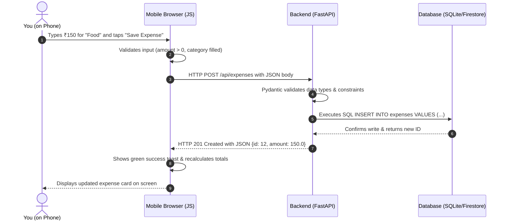

# Trakerz Milestone 3 — First-Year CSE Student Learning Guide

Welcome to the **Trakerz Learning Guide**! If you are a first-year Computer Science & Engineering student, larger codebases with multiple directories, frameworks, and APIs can feel intimidating.

This guide was written specifically for you. It explains how every part of Milestone 3 fits together using simple analogies, real-world examples, and step-by-step code walkthroughs.

---

## 1. How Frontend, Backend, and Database Relate

To understand modern web applications, think of a **Restaurant**:

```
+-------------------------------------------------------------+
|                     THE RESTAURANT ANALOGY                  |
|                                                             |
|  [ Customer / Phone ]  ====>  [ Waiter / Backend ]  ====>  [ Pantry / Database ]
|    Customer chooses food        Takes order, checks         Retrieves / stores 
|    from visual menu             menu rules, delivers        raw ingredients    
|    (Frontend: HTML/CSS/JS)      (Backend: FastAPI)          (Database: SQLite) 
+-------------------------------------------------------------+
```

1. **The Customer (Frontend — HTML, CSS, JavaScript):**
   * This is what runs in your phone's browser.
   * Its job is strictly presentation and user interaction: showing pretty buttons, capturing what you type, and displaying numbers in Indian Rupees (`₹`).
   * The browser **never** talks directly to the database file on your computer for security and architecture reasons.
2. **The Waiter & Kitchen (Backend — Python FastAPI):**
   * Runs as a server process on your machine.
   * Listens for incoming network requests over HTTP.
   * Acts as the gatekeeper: verifies that amounts are positive numbers, categories are not empty, and dates are valid.
3. **The Storage Pantry (Database — SQLite / Cloud Firestore):**
   * The place where data actually survives after the program closes.
   * In **Local Mode**, it's an organized binary file on your disk (`trakerz_m3.db`).
   * In **Cloud Mode**, it's Google's Cloud Firestore servers across the internet.

---

## 2. What Happens When You Press "Add Expense"?

Here is the exact journey of an expense from the moment your finger touches the screen:



### In Code:
1. **Frontend Event (`app.js`):**
   ```javascript
   DOM.expenseForm.addEventListener("submit", async (e) => {
     e.preventDefault(); // Prevents full-page browser reload
     const body = JSON.stringify({ amount: 150.0, category: "Food", date: "2026-11-24" });
     const res = await fetch("/api/expenses", { method: "POST", body, headers: { "Content-Type": "application/json" } });
   });
   ```
2. **Backend Validation (`models/expense.py`):**
   ```python
   class ExpenseBase(BaseModel):
       amount: float = Field(..., gt=0) # Automatically rejects 0 or negative numbers!
       category: str = Field(..., min_length=1)
   ```
3. **Database Write (`database/sqlite_db.py`):**
   ```python
   cursor.execute("INSERT INTO expenses (category, amount, date) VALUES (?, ?, ?)", (cat, amt, dt))
   ```

---

## 3. What are APIs, HTTP, and JSON?

### What is an API?
**API** stands for *Application Programming Interface*. It is simply a formal agreement or "menu" that allows two different computer programs to talk to each other. In our case, the JavaScript on your smartphone talks to the Python code on your laptop through the API.

### How HTTP Works
When your browser talks to the backend, it sends an **HTTP Request**:
* **URL (Where to go):** e.g. `http://192.168.1.15:8000/api/expenses`
* **Method (What action to take):**
  * `GET` &rarr; Retrieve data (e.g. read list of expenses).
  * `POST` &rarr; Create new data (e.g. record a new expense).
  * `PUT` &rarr; Update existing data (e.g. fix a typo in amount).
  * `DELETE` &rarr; Delete data (e.g. remove an expense).
* **HTTP Status Codes (What happened?):**
  * `200 OK` &rarr; Request succeeded!
  * `201 Created` &rarr; New resource successfully saved!
  * `404 Not Found` &rarr; The expense ID you requested doesn't exist.
  * `422 Unprocessable Entity` &rarr; Validation failed (e.g. negative amount).
  * `500 Internal Server Error` &rarr; Python crashed or unhandled exception.

### What is JSON?
**JSON** (*JavaScript Object Notation*) is plain text formatted as key-value pairs. It is the universal language of web applications.

Compare how the same expense looks in Python vs JavaScript vs JSON:

* **Python Dictionary:**
  ```python
  {"category": "Food", "amount": 250.0}
  ```
* **JavaScript Object:**
  ```javascript
  { category: "Food", amount: 250.0 }
  ```
* **JSON String (sent over network cable/Wi-Fi):**
  ```json
  {"category": "Food", "amount": 250.0}
  ```

---

## 4. Tour of Important Files

| File | Purpose in Plain English |
| :--- | :--- |
| `backend/run.py` | The starting launcher. Prints your IP address and starts the Uvicorn web server. |
| `backend/app/main.py` | The heart of FastAPI. Configures middleware, attaches routes, and serves the mobile HTML frontend. |
| `backend/app/config.py` | Reads environment variables (such as database type or credentials path) from `.env`. |
| `backend/app/models/expense.py` | Pydantic classes that guard your data and ensure nobody submits invalid inputs. |
| `backend/app/database/base.py` | An abstract blueprint (`BaseExpenseDatabase`) declaring what any database engine must do. |
| `backend/app/database/sqlite_db.py` | The local storage engine that executes SQL queries against SQLite. |
| `backend/app/database/firestore_db.py` | The cloud storage engine that communicates with Google Cloud Firestore. |
| `backend/app/routes/expenses.py` | The URL endpoints (`/api/expenses`, `/api/health`, `/api/analytics/*`). |
| `mobile/index.html` | The single-page mobile layout: dashboard, buttons, lists, and modals. |
| `mobile/css/style.css` | The responsive styling designed for single-hand mobile use and dark aesthetic. |
| `mobile/js/app.js` | The client-side logic that calls the API, handles clicks, and updates the screen. |
| `mobile/service-worker.js` | Enables the Progressive Web App (PWA) shell to cache locally on your phone. |
| `tests/test_e2e.py` | The automated test suite running 23 checks verifying all features work. |

---

## 5. How FastAPI Routes & Dependency Injection Work

In FastAPI, you define endpoints using Python decorators like `@app.get()` or `@router.post()`:

```python
@router.get("/expenses")
def list_expenses(service: ExpenseService = Depends(get_service)):
    return service.list_expenses()
```

### What is `Depends(get_service)`?
This is called **Dependency Injection**. Instead of hardcoding which database to use inside every function, FastAPI automatically calls `get_service()`, which looks at your settings (`STORAGE_MODE`), selects SQLite or Firestore, and hands the prepared service to your endpoint function.

This allows us to switch from Local SQLite to Cloud Firestore with **zero changes to the API route code**!

---

## 6. How Database CRUD Operations Work

**CRUD** stands for **C**reate, **R**ead, **U**pdate, **D**elete:

| Operation | SQL in SQLite (`sqlite_db.py`) | NoSQL in Firestore (`firestore_db.py`) |
| :--- | :--- | :--- |
| **Create** | `INSERT INTO expenses (...) VALUES (...)` | `col.document().set(doc_data)` |
| **Read** | `SELECT * FROM expenses ORDER BY date DESC` | `col.order_by("date").stream()` |
| **Update** | `UPDATE expenses SET amount = ? WHERE id = ?` | `doc_ref.update({"amount": new_amount})` |
| **Delete** | `DELETE FROM expenses WHERE id = ?` | `doc_ref.delete()` |

---

## 7. How to Debug Common Errors

### 1. `Error: [Errno 10048] error while attempting to bind on address ('0.0.0.0', 8000)`
* **What it means:** Another program (or a previous run of your server) is already using port 8000.
* **How to fix:**
  * Find and terminate the old process in PowerShell:
    ```powershell
    Get-Process -Id (Get-NetTCPConnection -LocalPort 8000).OwningProcess | Stop-Process -Force
    ```
  * Or simply run on a different port:
    ```powershell
    python run.py --port 8080
    ```

### 2. My Phone Says "This site can't be reached" (Connection Timed Out)
* **What it means:** The phone's network packets cannot reach your laptop.
* **Checklist:**
  1. Are both phone and laptop on the exact same Wi-Fi network? (Make sure the phone didn't switch to 4G/5G mobile data).
  2. Did you type `http://` instead of `https://`? (Local development uses `http://`).
  3. Windows Firewall might be blocking incoming connections. Temporarily allow port 8000 in PowerShell:
     ```powershell
     New-NetFirewallRule -DisplayName "Trakerz Mobile" -Direction Inbound -LocalPort 8000 -Protocol TCP -Action Allow
     ```

### 3. `422 Unprocessable Entity`
* **What it means:** The data you sent in the request body violated Pydantic's validation rules (e.g. `amount` was 0 or a string, or `category` was blank).
* **How to fix:** Check the error message in the API response or console. Pydantic tells you the exact field and error.

---

## 8. Guided Practice Exercises (Try These Yourself!)

Here are 3 small practice exercises to build your confidence modifying the code:

### Exercise 1: Add a New Quick Category Chip
* **Goal:** Add a "Gaming 🎮" category chip to the Add Expense modal.
* **Steps:**
  1. Open `C:\Trakerz\milestone_3\mobile\index.html`.
  2. Find the `<div class="quick-categories">` block.
  3. Add a new button: `<button type="button" class="cat-chip" data-cat="Gaming">🎮 Gaming</button>`.
  4. In `C:\Trakerz\milestone_3\mobile\js\app.js`, add `gaming: "🎮"` to `CATEGORY_EMOJIS`.
  5. Refresh your browser and test it!

### Exercise 2: Change Currency Symbol
* **Goal:** Understand where currency presentation is handled.
* **Steps:**
  1. Open `C:\Trakerz\milestone_3\mobile\js\app.js`.
  2. Find the `formatINR` function. Notice how `toLocaleString("en-IN")` formats comma separators Indian-style (`1,00,000`).
  3. Notice how the currency symbol `₹` is separated from the raw numbers in `index.html` and `style.css` so numbers can be calculated mathematically while styled visually.

### Exercise 3: Add an Average Expense Metric
* **Goal:** Calculate and display the average spending per expense.
* **Steps:**
  1. Open `C:\Trakerz\milestone_3\mobile\index.html`.
  2. In the `.hero-stats-row` section, add a third column for "Average Spend".
  3. In `app.js` inside `renderDashboard()`, calculate `avg = state.summary.total_amount / (state.summary.expense_count || 1)`.
  4. Set the text content of your new element to `₹${formatINR(avg)}`.
